<div align="center">

[](README.md)
[](README.kr.md)

# 🛒 R6S: 테무 에디션

### *레인보우 식스 시즈(2015)를 테무에서 시켰더니 배송 중에 떨어진 부품까지 다시 붙여서 온 버전.*

실측 스케일로 다시 지은 오리지널 House. 제대로 부서지는 벽. 레펠, 드론, 감시 카메라.<br>
테러리스트 헌트, 방 코드 PvP, 로컬이나 클라우드에서 들어오는 AI 에이전트까지. **설치 없음.** 그냥 웹사이트입니다.


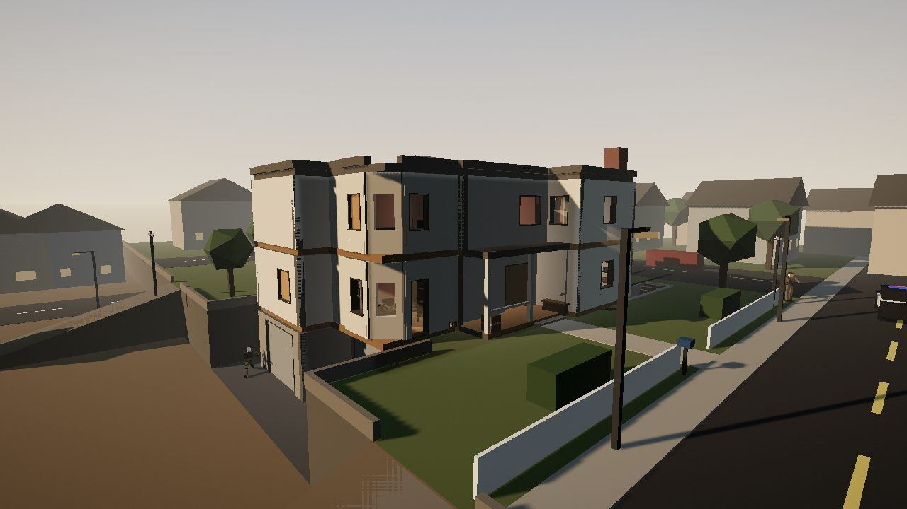

</div>

> **이게 뭔가요?** 초창기 시즈를 브라우저 탭에 담은 비상업 팬 오마주입니다.
> 프롬프트 한 번으로 만든 [lowbudget-r6s-oneshot](https://github.com/Toddoward/lowbudget-r6s-oneshot)의 **퓨샷** 후속작입니다.
> 원샷은 돌아가긴 했지만 문제가 27개, 거기에 추가로 찾은 것까지 있었습니다. 이 저장소는 그걸 고친 버전입니다.
> 문제 목록과 원샷이 만들어진 과정은 원샷 README에 정리되어 있습니다.

---

## 🔧 원샷에서 달라진 점

| 분야 | 원샷 | 퓨샷 |
|---|---|---|
| **브라우저 단축키** | 앉기가 <kbd>Ctrl</kbd>라서 교전 중 <kbd>Ctrl</kbd>+<kbd>W</kbd>로 탭이 닫힘 | 보조키를 아예 쓰지 않음. 전체 화면 + 키보드 잠금으로 나머지 단축키도 막음(선택) |
| **커서** | 사망·메뉴·결과 화면에서도 포인터 잠금이 안 풀림 | 상태 머신으로 처리: <kbd>Esc</kbd>는 일시 정지, 사망·라운드 종료·대기실·메뉴에서는 커서가 자동으로 풀리고, 다시 시작할 땐 "클릭해서 조작 시작"이 뜸 |
| **맵** | 기억에 의존해 재구성, 비율이 틀림 | 실제 House 모델에서 추출: ×2.85 스케일, 층 높이 B −3.5 / 1F 0 / 2F 3.5 / 지붕 7 m, 천장 3.2 m, 캡슐 1.8 m. 하드·소프트·세미 벽이 눈으로 구분됨. 문 아래 틈 19 cm, 드론 환풍구 6개, 탄약 상자, CCTV 6대 |
| **기울이기와 조준경** | 기울이면 총이 같이 돌아가서 시점과 탄착이 어긋남. 총 본체가 조준경을 가림 | 조준경 기준으로 ADS 회전. 조준경 속이 비어 있음. 레드닷·홀로·ACOG 레티클은 **광학 콜리메이션** 방식(총열 축 무한원점에 그려서 점 찍힌 곳에 탄이 감). 권총은 야광 가늠쇠와 뚫린 가늠자 |
| **넘어가기** | 창문만 가능 | 높이 1.3 m 이하면 전부 가능. 얇은 건 넘어가고(창틀·난간·브리칭 구멍), 깊은 건 올라섬(카운터·상자) |
| **벽 강화** | 손상된 벽은 강화 불가 | 총알 자국이나 구멍이 난 소프트월도 강화 가능. 써마이트로 뚫린 벽만 불가 |
| **드론** | 점프가 약하고 환풍구가 없고 핑이 안 되고 밤엔 깜깜 | 점프 강화, 문 틈과 환풍구 통과, 적을 핑하면 팀 전체에 표시, 밤엔 자동 노출 + 작은 LED |
| **봇** | 첫 발이 무조건 맞음 | 표적을 잡을 때 생기는 오차가 1초쯤에 걸쳐 줄어들고 초탄이 흩어짐. 보통 난이도 초탄 명중률 70% → 약 0~10%. 섬광에 눈이 멂 |
| **UI** | 영어뿐, 정보 부족 | 한국어/영어 지원. 메인 메뉴 깊이 1단. 오퍼레이터를 역할별로 묶고 정보 카드 제공. HUD에 팀 목록, 월드 마커(적 발견·핑·목표), 상황에 맞는 키 안내. <kbd>F1</kbd>로 전체 키맵. 모든 키 재설정 가능 |
| **가젯** | 숫자키 3/4 + 클릭 | <kbd>G</kbd>는 오퍼레이터 가젯, <kbd>X</kbd>는 브리칭 차지. **길게 눌러 설치, 짧게 눌러 기폭**(벽을 보고 있어도 됨). 밴딧 전선이 터질 때 스파크와 소리 |
| **오퍼레이터** | 11명 | 16명. **IQ, 몽타뉴, 블리츠, 캅칸, 타찬카** 추가 |
| **디버그 기능** | 모두에게 배포됨 | 로컬 에이전트 슬롯, 같은 브라우저 방, X-ray, 오버레이는 QA 빌드에만 들어감(`develop` 프리뷰). 프로덕션에는 없음 |
| **네트워크** | 연결이 끊기면 그대로 퇴장 | **자리 유지 재접속**: 서버가 20초 동안 자리를 남겨 두고, 클라이언트가 토큰으로 다시 붙으면 같은 ID·에이전트·놓친 파괴 상태를 그대로 돌려받음. 하트비트로 반쯤 끊긴 소켓도 감지 |
| **테스트** | 스모크 테스트뿐 | **UX 시나리오 35개** 추가: 메뉴→플레이, 상태 전환, 공격·수비 모든 역할, 온라인 재접속. 이 과정에서 실제 버그 8개를 찾아 고침 |

---

## 📸 스크린샷

<table>
<tr><td width="50%">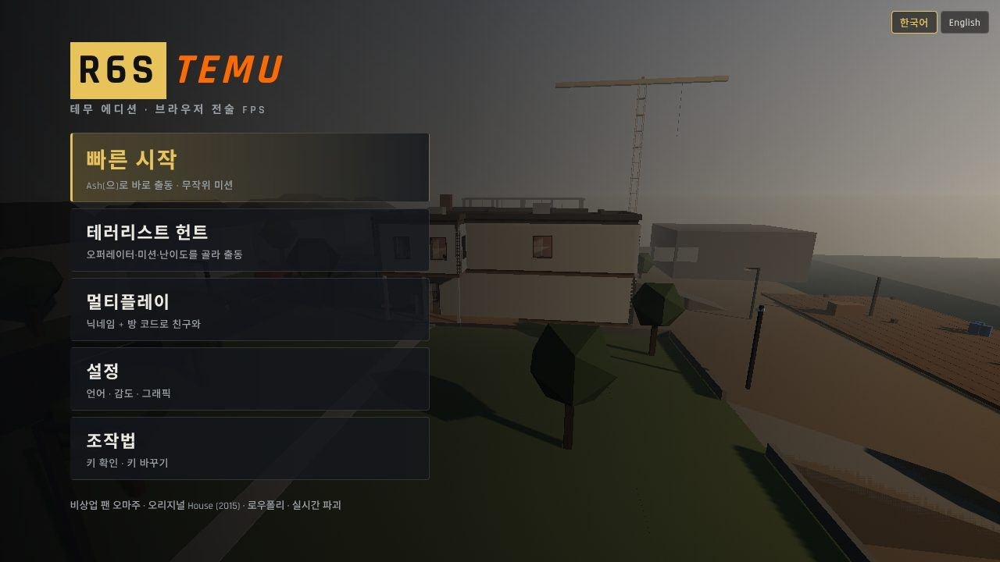</td><td width="50%">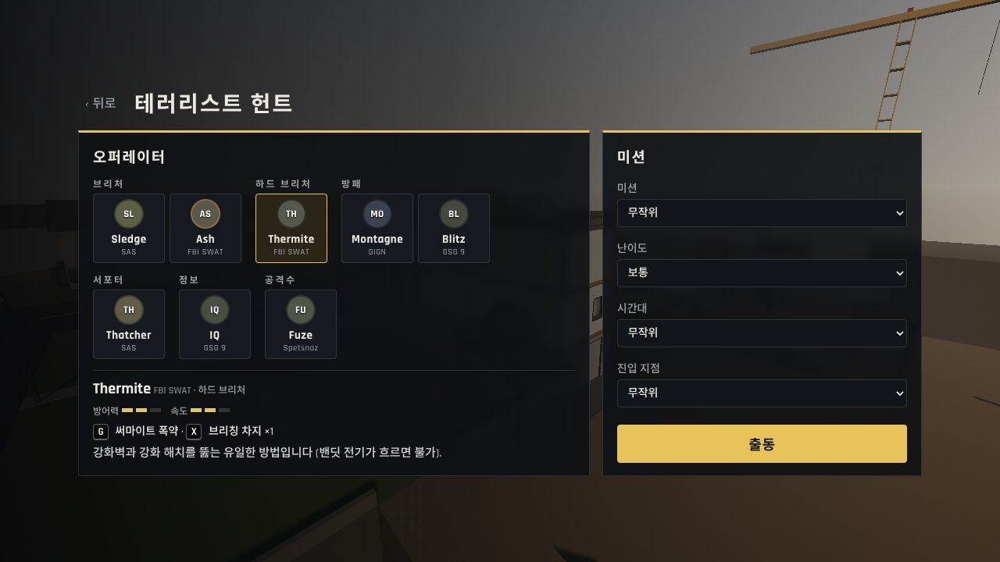</td></tr>
<tr><td><b>깊이 1단 메뉴.</b> 빠른 시작, 테러리스트 헌트, 멀티플레이, 설정, 조작법.</td><td><b>역할별 오퍼레이터.</b> 방어력·속도, 가젯 키, 설명을 함께 보여줌.</td></tr>
<tr><td>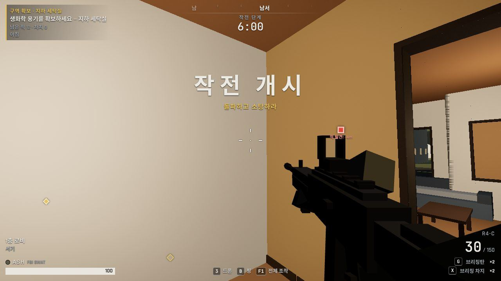</td><td>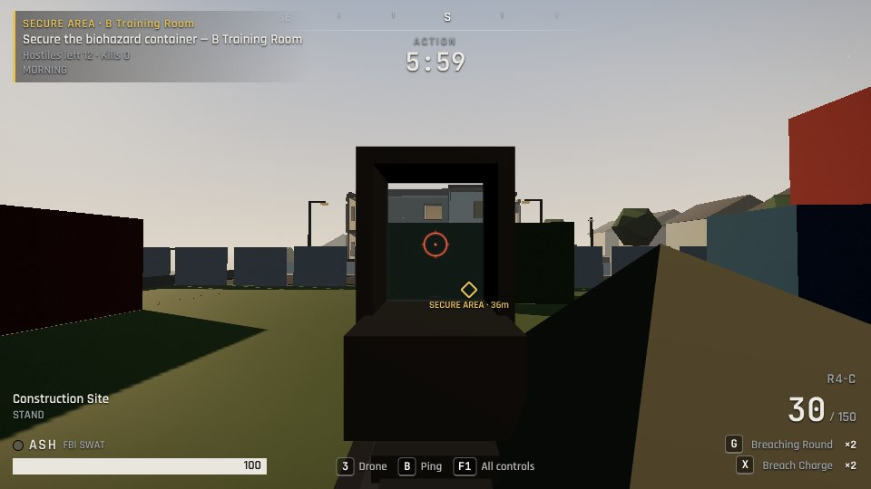</td></tr>
<tr><td><b>HUD.</b> 목표, 타이머, 나침반, 적 발견·핑 마커, 키가 표시된 가젯 슬롯, 상황별 키 안내.</td><td><b>콜리메이션 조준경.</b> 레티클이 총열 축 무한원점에 있고 유리가 깨끗함. 기울여도 조준이 어긋나지 않음.</td></tr>
<tr><td>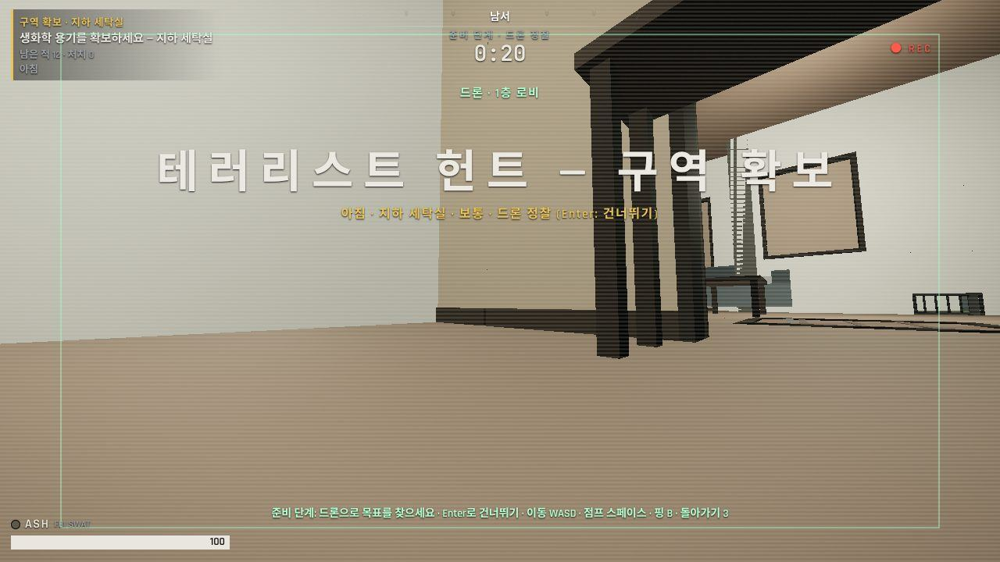</td><td>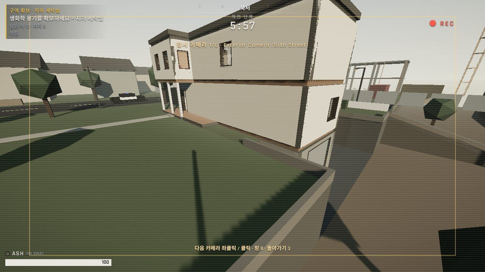</td></tr>
<tr><td><b>드론.</b> 문 틈과 환풍구를 지나가고, <kbd>B</kbd>로 본 것을 팀에 핑.</td><td><b>수비팀 CCTV</b> (<kbd>3</kbd>). 클릭하면 다음 카메라. 공격팀이 쏴서 부술 수 있음.</td></tr>
<tr><td>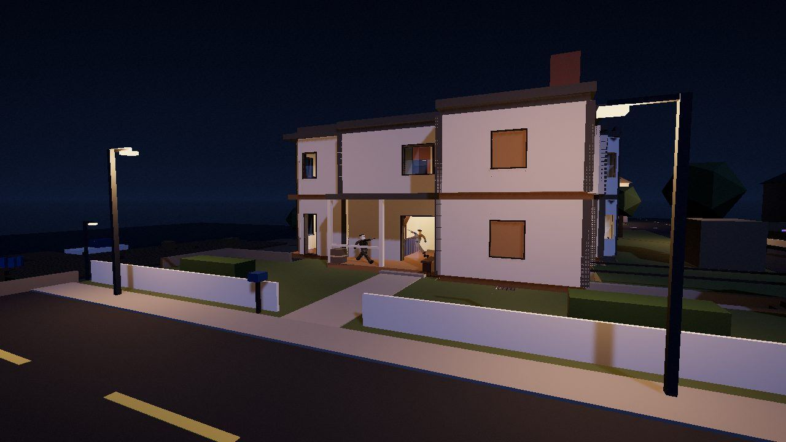</td><td>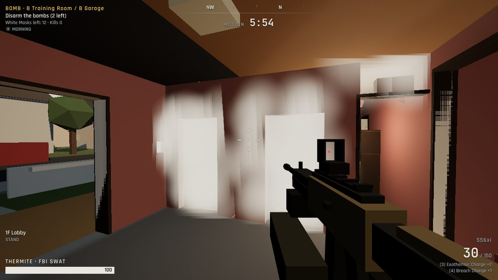</td></tr>
<tr><td><b>플레이할 수 있는 밤.</b> 달빛, 가로등, 불 켜진 창문.</td><td><b>파괴.</b> 브리칭 차지, 슬레지, 애쉬, 그냥 총알로도 소프트월이 칸 단위로 부서짐.</td></tr>
<tr><td>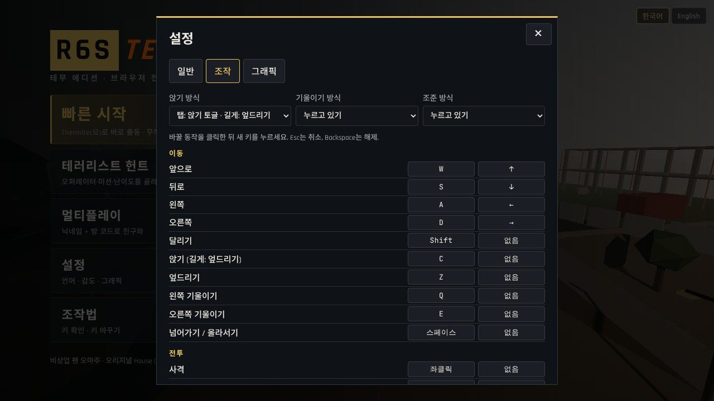</td><td>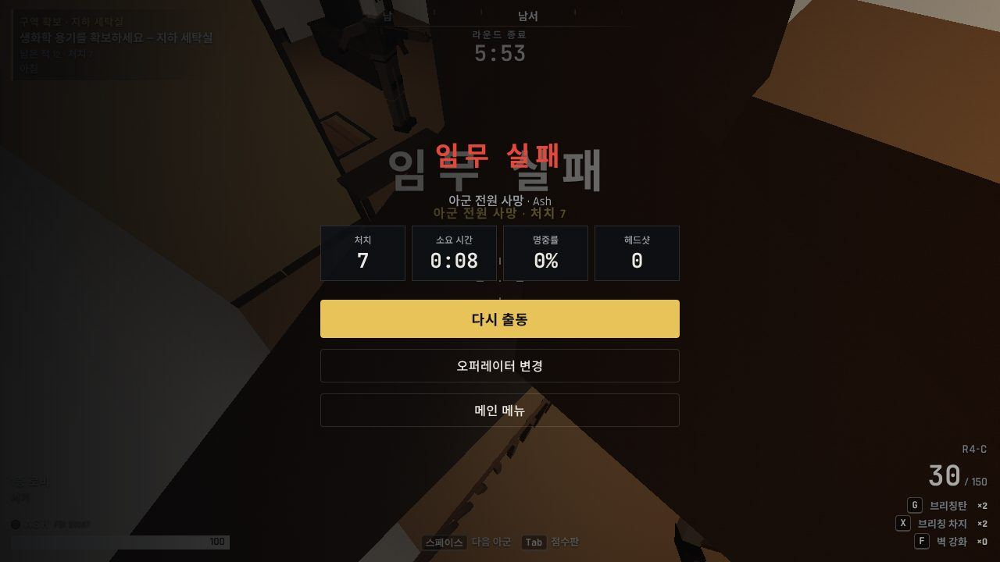</td></tr>
<tr><td><b>모든 키 재설정 가능.</b> 앉기·기울이기·조준은 누르고 있기/토글 선택. 키가 겹치면 자동 정리.</td><td><b>결과 화면.</b> 처치, 시간, 명중률, 헤드샷. 다시 출동, 오퍼레이터 변경, 메인 메뉴.</td></tr>
</table>

---

## ⌨️ 조작법

키는 전부 <kbd>WASD</kbd> 근처에 있고 <kbd>Ctrl</kbd>/<kbd>Alt</kbd>/<kbd>⌘</kbd>는 쓰지 않습니다. 화면 아래에는 지금 필요한 키만 보이고, <kbd>F1</kbd>을 누르면 전체 키가 나옵니다. **설정 → 조작**에서 모든 키를 바꿀 수 있습니다.

| 키 | 동작 | 키 | 동작 |
|---|---|---|---|
| <kbd>W</kbd><kbd>A</kbd><kbd>S</kbd><kbd>D</kbd> | 이동 | <kbd>Shift</kbd> | 달리기 |
| <kbd>C</kbd> | 앉기(탭) · 엎드리기(길게) | <kbd>Z</kbd> | 엎드리기 |
| <kbd>Q</kbd> / <kbd>E</kbd> | 기울이기 | <kbd>Space</kbd> | 넘어가기 / 올라서기 · 로프 놓기 |
| <kbd>좌클릭</kbd> / <kbd>우클릭</kbd> | 사격 / 조준 | <kbd>R</kbd> · <kbd>V</kbd> | 재장전 · 근접 공격 |
| <kbd>1</kbd> / <kbd>2</kbd> | 주무기 / 보조무기 | <kbd>F</kbd> | **상황별:** 바리케이드, 강화, 레펠, 탄약, 인질, 폭탄, 기관총 거치 |
| <kbd>G</kbd> | **오퍼레이터 가젯:** 탭 = 장착·투척·토글·기폭, 길게 = 설치 | <kbd>X</kbd> | **브리칭 차지:** 길게 = 설치, 탭 = 기폭 |
| <kbd>3</kbd> | 드론(공격) / 감시 카메라(수비) | <kbd>B</kbd> / <kbd>휠 클릭</kbd> | 핑 / 적 표시 |
| | | <kbd>Tab</kbd> · <kbd>F1</kbd> | 점수판 · 전체 조작 |

---

## 🪖 오퍼레이터

| 공격팀 | 역할 | 가젯 | | 수비팀 | 역할 | 가젯 |
|---|---|---|---|---|---|---|
| **슬레지** | 브리처 | 브리칭 해머 | | **스모크** | 서포터 | 원격 가스 수류탄 |
| **애쉬** | 브리처 | 브리칭탄 | | **뮤트** | 안티 가젯 | 신호 교란기 |
| **써마이트** | 하드 브리처 | 써마이트 폭약(강화벽 돌파) | | **캐슬** | 앵커 | 방탄 바리케이드 |
| **대처** | 서포터 | EMP 수류탄 | | **펄스** | 정보 | 심박 센서 |
| **퓨즈** | 서포터 | 집속탄 | | **예거** | 안티 가젯 | ADS 요격기 |
| **몽타뉴** 🆕 | 방패 | 확장 방패(전신 엄폐) | | **밴딧** | 안티 가젯 | 쇼크 와이어 |
| **블리츠** 🆕 | 방패 | 섬광 방패(6 m / 60°) | | **캅칸** 🆕 | 트래퍼 | 진입 거부 장치 |
| **IQ** 🆕 | 정보 | 벽 너머 전자장비 탐지 | | **타찬카** 🆕 | 앵커 | 거치형 기관총 |

---

## 🏠 House

House 3D 모델에서 평면을 추출해 맵을 만들었습니다([`tools/level`](tools/level/README.md)). 평면을 ×2.85로 키우고, 분해도처럼 떠 있던 층들을 B −3.5 / 1F 0 / 2F 3.5 / 지붕 7 m로 다시 쌓았습니다. 그래서 1.8 m 캐릭터, 2.2~2.4 m 문, 3.2 m 천장이 실제 비율대로 맞습니다.

- **벽:** 하드(안 부서짐) · 소프트(총알 구멍, 머더홀, 1.8×2.2 m 돌파, 관통하면 피해 −40%) · 세미(25 cm 간격 샛기둥·장선이 남아서 보고 쏠 수는 있지만 지나갈 수는 없음)
- **개구부:** 바리케이드 아래 18~20 cm 틈, 드론 환풍구 6개, 해치 4개, 포치 위 2층 열린 창문, 차고 셔터
- **외부:** 정문 포치(북), 차고 진입로(동), 뒤 포치와 측면 계단(남), 창고 외부 계단(북서)

---

## 🤖 AI 에이전트 (로컬·클라우드)

에이전트도 사람과 똑같은 플레이어입니다. `#webmcp-agent-bridge` DOM이나 `window.webmcp`로 화면 정보를 읽고, **사람과 같은 입력 경로**로 움직입니다. 물리, 반동, 초당 540° 회전 제한, <kbd>G</kbd>/<kbd>X</kbd>/<kbd>F</kbd> 상황 키까지 전부 같습니다. 벽 너머는 보이지 않습니다.

| 에이전트 위치 | 접속 방법 |
|---|---|
| **클라우드**(컨테이너, CI, 브라우저 도구가 있는 LLM) | 헤드리스 Chromium으로 `https://r6s-temu.pages.dev/?room=R6-8492&nick=MyAgent&agent=1` 열기, 또는 `node tools/agents/webmcp-playwright-agent.mjs --url https://r6s-temu.pages.dev --room R6-8492` 실행 |
| **로컬** | 같은 방법으로 `http://localhost:5173`에 접속, 또는 페이지에서 `await webmcp.join({ nickname, roomCode })` 실행 |

📖 전체 규약은 **[AGENT_CONTEXT.md](AGENT_CONTEXT.md)**에 있고, 게임 안 **AI 에이전트 접속 가이드**에서도 볼 수 있습니다.

---

## 🚀 실행 · 브랜치 · 테스트 · 배포

```bash
npm install && npm run dev        # http://localhost:5173 (개발 모드 = QA 기능 켜짐)
npm run build                     # 타입체크 + 프로덕션 빌드
npm test                          # 단위 테스트
npm run test:e2e                  # 스모크 E2E (QA 빌드 대상)
E2E_ONLINE=1 npm run test:scenarios   # UX 시나리오 35개 (S5는 npm run dev:worker 필요)
```

| 브랜치 | 빌드 | 배포 위치 |
|---|---|---|
| `main` | 프로덕션 빌드, QA 기능 제외 | `r6s-temu.pages.dev` |
| `develop` | `VITE_QA=1`: 로컬 에이전트 슬롯, 같은 브라우저 방, X-ray(<kbd>K</kbd>), 오버레이(<kbd>O</kbd>) | `develop.r6s-temu.pages.dev` |

원샷과는 별도로 배포합니다. Pages 프로젝트 이름은 `r6s-temu`, Worker + Durable Object 이름은 `r6s-temu-matchmaker`입니다.
저장소 시크릿에 `CLOUDFLARE_API_TOKEN`(Workers Scripts: Edit, Cloudflare Pages: Edit 권한)과 `CLOUDFLARE_ACCOUNT_ID`를 넣고 `main`에 푸시하면 CI가 테스트를 돌린 뒤 배포합니다. 시크릿이 없으면 빌드와 테스트만 하고 배포는 건너뜁니다.

---

<div align="center">
<sub>House 모델 참고: crusader1291의 "Rainbow Six Siege - House Map"(Sketchfab). 이 저장소에는 포함하지 않았습니다.<br>
Ubisoft와 무관한 비상업 팬 오마주입니다. "Rainbow Six Siege"와 오퍼레이터 이름은 각 권리자의 것입니다. 세관에는 보내지 말아 주세요. 📦</sub>
</div>
